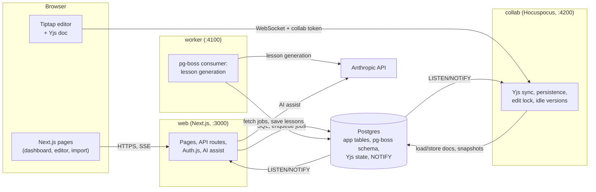

# Architecture

How the lesson authoring workflow is built and why. The requirements it answers are in
[requirements/lesson-authoring.md](requirements/lesson-authoring.md) (cited as Rn). Each module
under `src/` that has a `README.md` holds its detailed contract; this page is the map.

## Services and processes

One npm package, one TypeScript codebase, three long-running processes and one Postgres database.
Locally `npm run dev` starts all three; on Railway they are three services built from one image
(see [deploy.md](deploy.md)).



| Process | Code                           | Responsibilities                                                                                                                                                 |
| ------- | ------------------------------ | ---------------------------------------------------------------------------------------------------------------------------------------------------------------- |
| web     | `src/app`, `src/proxy.ts`      | Server-rendered pages, API routes, sign-in, role checks, outline import, starting and cancelling runs, AI assist, export, the SSE progress feed, collab tokens   |
| worker  | `src/worker`, `src/generation` | Runs one pg-boss job per lesson: builds the prompt, calls the model, validates, post-processes and saves; enforces caps; recovers from crashes                   |
| collab  | `src/collab`                   | Hocuspocus server: authenticates each socket, loads and stores Yjs documents, snapshots valid content to the lesson, takes idle versions, enforces the edit lock |

The three processes never call each other. They share state only through Postgres: tables,
pg-boss jobs, and `LISTEN`/`NOTIFY` channels (`generation_progress`, `lesson_status_changed`,
`lesson_content_replaced`). That keeps the worker free of any public port and lets each process
restart on its own. Every process answers `GET /health` with 200 only when it can reach the
database.

## Data model

Drizzle schema in `src/db/schema.ts`, migrations in `drizzle/`. UUID keys, snake_case enums, money
as `numeric(12,6)`.

| Table               | Holds                                                                                                                                                                  | Key relations                                                                     |
| ------------------- | ---------------------------------------------------------------------------------------------------------------------------------------------------------------------- | --------------------------------------------------------------------------------- |
| `users`             | Email, name, bcrypt hash, role (`author`, `reviewer`, `approver`, `admin`)                                                                                             |                                                                                   |
| `units`             | Grade, unit number, anchor text title, ISBN, banner, ELD warnings                                                                                                      | `created_by` → users                                                              |
| `arcs`              | Arc name, description, order                                                                                                                                           | → units                                                                           |
| `lessons`           | Every outline cell (plus `raw_row`), lesson number (null for flex days), position, status, `content` (JSONB lesson), assignee, last editor, import warnings, ELD input | → units, arcs; `assignee_id`, `last_edited_by` → users                            |
| `pending_imports`   | A parsed outline between preview and confirm                                                                                                                           | → users                                                                           |
| `standards`         | Code, framework, grade, strand, full text, extra source fields                                                                                                         |                                                                                   |
| `lesson_standards`  | A lesson's normalized codes by kind (`focus`, `supporting`, `media`, `eld`)                                                                                            | → lessons; deliberately no FK to `standards` (unknown codes are kept and flagged) |
| `prompt_versions`   | A unit's prompt template (system, style guide, per-type guidance), numbered per unit                                                                                   | → units                                                                           |
| `generation_runs`   | Model, prompt version, status, cap, running cost                                                                                                                       | → units, prompt_versions                                                          |
| `generation_jobs`   | One per lesson per run: status, attempts, error, tokens, cost                                                                                                          | → generation_runs, lessons (unique per run and lesson)                            |
| `lesson_versions`   | Content snapshots with author, time and contributors                                                                                                                   | → lessons                                                                         |
| `workflow_events`   | Every status transition: from, to, actor, note, time                                                                                                                   | → lessons                                                                         |
| `assignment_events` | Every (re)assignment with the actor                                                                                                                                    | → lessons                                                                         |
| `yjs_documents`     | The encoded Yjs state per collaborative document                                                                                                                       | keyed by document name `lesson:<id>`                                              |
| `assist_calls`      | Each AI assist call's model, tokens and cost                                                                                                                           | → lessons (set null on delete, so spend survives), users                          |

pg-boss keeps its queue in its own `pgboss` schema in the same database. A lesson's generation
provenance (model, prompt version, tokens, cost) is read from its latest generated job joined to
the run and prompt version, so it isn't stored twice.

## The lesson schema: one source of truth

`src/lesson/schema.ts` is a single Zod module that defines a lesson: front matter (copied from the
outline row, never generated), then a body of objectives, essential questions, connections,
vocabulary, materials, and sections (Launch, Literacy Lab, Learning in Action, Look Back) made of
parts made of 18 typed blocks (Say, Ask with exemplar response, teacher tip, pulse check, ELD
instructions, student support, and so on), plus homework. Text fields allow only `**bold**` and
`*italic*`. Sections, parts and blocks carry stable ids.

The same module produces the JSON schema the model is asked to follow, validates every generated
lesson and every editor snapshot, and is the input the editor schema is derived from (below). One
schema means the generator, validator, editor and export can't drift apart; it also keeps the
model's job small, since front matter is filled from the outline rather than generated.
`validateLesson` adds cross-field checks the schema can't express: section minutes sum to 50 ×
days, every focus standard appears in the front matter and is tagged on a Learning in Action part.

## Generation pipeline

```mermaid
sequenceDiagram
  autonumber
  actor A as Author
  participant W as web
  participant PG as Postgres + pg-boss
  participant K as worker
  participant M as Anthropic API
  A->>W: Start generation (model, cap)
  W->>PG: run row pinned to the prompt version,<br/>one job row + one pg-boss job per lesson
  W-->>A: 201, returns at once
  loop up to GENERATION_CONCURRENCY at a time
    K->>PG: fetch job; check run status and caps
    K->>PG: job + lesson Generating, NOTIFY
    K->>K: build prompt (template, outline row,<br/>standards full text, neighbours, ELD)
    K->>M: system + schema + prompt (streamed)
    M-->>K: JSON lesson body
    K->>K: parse, merge front matter, validateLesson
    alt invalid and attempts left
      K->>M: repair prompt with the validation errors
    end
    K->>K: post-process (pulse check, labels, vocabulary, ids)
    K->>PG: save content + version, Draft, tokens and cost, NOTIFY
  end
  PG-->>W: NOTIFY generation_progress
  W-->>A: SSE event, page re-renders
```

**Starting a run** (`src/generation/service.ts`). `startRun` creates a `generation_runs` row pinned
to the unit's current prompt version and model, a `generation_jobs` row for each numbered lesson
(flex days only on request), and a pg-boss job for each, then returns; it never calls the model.
The start dialog shows the estimate first: the measured average cost of this unit's lessons on that
model when there are any, else a per-lesson token estimate times the model's price.

**Prompt building** (`prompt_input.ts`, `prompt_builder.ts`). For each lesson the worker loads the
outline row (every column and the raw lesson type), the arc description, the previous and next
numbered lessons' descriptions, the non-empty ELD input, and the **full text of every focus,
supporting, media literacy and ELD standard** from the reference data (unknown codes are passed by
code). The system prompt holds the unit's template: system instructions, the style guide and the
guidance for this lesson's type only (Core Reading, Core Writing with teacher modeling and a
writing task, Academic Discussion with a discussion protocol, Spark, Writing, flex). The template
is written in our own words from studying public example lessons; no example lesson text is in
the repo. Authors edit it per unit; each save is a new numbered version and every lesson shows the
version it came from.

**Model call and structured output** (`anthropic_client.ts`). The lesson's JSON schema goes in the
system prompt and the model answers with a JSON object in its text, streamed, with thinking effort
`GENERATION_EFFORT` (default medium) and a 64k output ceiling. We tried the API's structured
output modes first: strict structured outputs reject a schema this size (too many optional fields,
then "grammar too large" for the 18-way block union), and tool input sometimes came back with a
whole section array as a malformed string. JSON in text had no parse failures in testing, and Zod
validation is the real gate either way.

**Validation and repair** (`worker.ts`). The answer is parsed, merged with the outline's front
matter and checked by `validateLesson`. Invalid output or a failed call is retried up to
`GENERATION_MAX_ATTEMPTS` (default 2) with every validation message in the repair prompt. Invalid
output is never saved: after the last attempt the job and lesson are Failed with the error, and
the other lessons carry on. Tokens of every attempt, failed or not, are charged to the job and
run.

**Post-processing** (`post_process.ts`). A pure function fixes what code can fix for free instead
of paying for a retry: it moves each pulse check's correct option to a per-lesson letter (models
otherwise favour one position), normalizes Learning in Action part labels, keeps at most 6
addressed vocabulary words that the lesson actually uses, and assigns ids. It runs after
validation and only reorders, relabels or filters, so it can't make a valid lesson invalid.

**Jobs, restarts and crashes** (`queue.ts`). pg-boss runs in the same Postgres. Each job checks
first whether its run was cancelled or its lesson already generated, so a restarted worker
resumes the remaining jobs without redoing finished ones. A running job keeps a pg-boss heartbeat
(`GENERATION_HEARTBEAT_SECONDS`, 60 s) instead of a fixed expiry: real calls took up to about two
minutes, so a short expiry would retry live calls and pay twice. The worker also sweeps every half
heartbeat for jobs whose worker died, so their lesson is retried within about a minute rather than
on pg-boss's slower monitor pass.

**Caps** (R12). Two limits apply: the run's cap (`GENERATION_SPEND_CAP_USD`, default $5, shown in
the start dialog, raisable by an admin with a Resume) and a global budget (`SPEND_CAP_USD`,
default $20) over every run and AI assist call in the database. A run is refused at start when its
estimate exceeds what is left of the global budget, and the worker checks both before every job.
When a cap is reached no new job starts and the unit shows "stopped: spend cap reached"; finished
lessons are kept.

> **Status: in progress.** The cap check above runs before each job, so jobs already in flight
> can finish past a cap: the overshoot is at most `GENERATION_CONCURRENCY` lesson costs. The M5
> hardening work (contract in `src/generation/README.md`, "M5 robustness contract") replaces this
> with **reservations**: a job reserves one lesson estimate when it starts
> (`generation_jobs.reserved_usd`) and releases it when it ends, and both guards compare spent +
> reserved with the cap under a Postgres advisory lock, so even several worker processes overshoot
> by at most one estimate. A job blocked only by others' reservations waits instead of stopping
> the run. The same work counts attempts across crash retries (a lesson never gets more than
> `GENERATION_MAX_ATTEMPTS` calls), fails lessons whose crash retries ran out so their run
> finishes, and stores non-blocking "review hints" for style slips code can't fix.

**Live progress** (R9). Each status change sends a `NOTIFY` on `generation_progress`. The web
process holds one `LISTEN` connection (`src/db/notify_hub.ts`) and fans events out to every open
dashboard's Server-Sent Events stream (`/api/units/:id/generation/events`). The dashboard is a
server component: on each event the client asks Next.js to re-render it from the database
(`router.refresh()`, debounced), and it also re-reads every 2.5 s while a run is active, which
covers a missed notification. There is one source of truth and no client-side state merging. A
lesson opens as soon as its own job is done.

## Standards grounding

The seed loads grade 6 CA CCSS ELA/Literacy (101 entries), CA ELD (30) and the CA Model School
Library Standards (59; the outline's "media literacy" column) from `data/standards/*.json`,
extracted reproducibly from the official PDFs by `scripts/standards/`. The importer normalizes the
outline's shorthand ("RL.6.1, 6.2" → RL.6.1, RL.6.2; "ELD.PI.6.6 – Exchange..." → ELD.PI.6.6;
"2.1.a" in the library column → LIB.6.2.1.a), keeps unknown codes and flags them in the preview
and on the lesson (the sample has one: RL.6.9.a doesn't exist).

The standards' full text is then used in three places: in every generation prompt (the model works
from the standard's wording, not its memory of a code), in the editor and lesson view (hover or
focus a code to read it; front-matter standards are picked from the reference data, not typed),
and in the AI alignment check, which judges each focus standard against its text. Validation
enforces that every focus standard is in the front matter and tagged on a Learning in Action part.

## Collaboration

**Editor schema derived from Zod** (`src/editor`). The Tiptap/ProseMirror schema is generated from
the lesson's Zod schema: one node per section, part and block type, and generic field nodes
(`field_text`, `field_list`, `field_group`) for the values inside them, keyed by field name, with
enums, numbers and standard codes in node attributes. A new block field needs no editor change,
and a test fails if a block type has no node. `lessonToDoc` and `docToLesson` round-trip every
valid lesson exactly. A structure guard lets typing change text and marks inside one field only;
structural edits (add or remove a block, part, list item or standard) go through commands, so the
document always maps back to a valid lesson shape.

**Yjs and Hocuspocus** (`src/collab`). Each lesson is one Yjs document, `lesson:<id>`. The browser
connects to the collab server with a short-lived token from `GET /api/collab-token` (HMAC-signed
with `AUTH_SECRET`, 10 minutes), which the server verifies before loading anything. On first
open the server seeds the Yjs document from `lessons.content` and stores it straight away, so two
clients never seed it twice. Awareness carries each user's name, colour and cursor.

**Persistence and snapshots.** The server stores the full Yjs state in `yjs_documents` (debounced
500 ms, at most 5 s), and in the same transaction converts the document back to a lesson with
`docToLesson`. When it validates, that becomes `lessons.content`, with the last editor and time;
when it doesn't (a reviewer is mid-edit and a required field is empty), only the Yjs state is
stored and the editor shows where the problem is. So `lessons.content` is always a valid lesson,
and everything else (dashboard, export, AI assist, generation provenance) reads it, never the Yjs
binary.

**Versions** (R14). A version is saved after 30 s without edits (with everyone who edited since
the last one as contributors), and before submit, approve, restore and regeneration when content
changed. Reviewers preview any version with its changes highlighted and restore it; a restore or
regeneration deletes the stored Yjs document and notifies the collab server, which replaces the
open document for everyone.

**Edit lock** (R23). The collab server sets each connection read-only when the lesson is Approved
or Generating, and flips every open connection when it hears `lesson_status_changed`; an edit that
raced the lock is replaced by the approved content. Open editors learn about status changes by
polling `GET /api/lessons/:id/status` every 2 s with an ETag (an SSE stream per editor tab held a
database connection and an HTTP/1.1 slot each, which ran out at a handful of tabs).

**A pinned dependency.** `@tiptap/y-tiptap` is pinned to 3.0.9. Version 3.0.10 writes a "position
migration" record for every structural or mark edit (about 1.5 MB each, never pruned); the server
also strips those records on load and store for documents created before the pin. A small plugin
re-maps the local caret after remote edits, because the library's own fallback put concurrent
typing in the same paragraph out of order.

## Review workflow

`src/workflow/transitions.ts` is a pure table of transitions and roles; the service applies them
inside a transaction that locks the lesson row, so concurrent actions serialize and the loser gets
a 409.

| Action          | From              | To                | Who (admins always) | Note     |
| --------------- | ----------------- | ----------------- | ------------------- | -------- |
| Submit          | Draft             | In review         | reviewer, approver  | optional |
| Resubmit        | Changes requested | In review         | reviewer, approver  | optional |
| Request changes | In review         | Changes requested | approver            | required |
| Approve         | In review         | Approved          | approver            | optional |
| Reopen          | Approved          | In review         | approver            | optional |

Generating → Draft or Failed are system transitions made by the worker. Every transition writes a
`workflow_events` row and the lesson's history shows them with assignments, generations and
versions in one timeline. The unit dashboard counts numbered lessons per status (flex days don't
block completion) and shows the unit complete when all are Approved. Authors and approvers assign
reviewers or approvers, singly or in bulk.

## AI assist and metering

AI assist runs in the web process (`src/assist`) on `ASSIST_MODEL` (Haiku-class by default) with
low thinking effort, and has three actions:

- **Selection** (R20): rewrite, shorten, simplify for the grade, or a free-form instruction on the
  selected text.
- **Regenerate a section** (R21): the section prompt includes the same generation prompt as the
  lesson (template, outline row, standards, neighbours), the section and the other sections'
  purposes; the result keeps the section's id, kind and minutes.
- **Alignment check** (R22): each focus standard's full text and the lesson body give a verdict
  (addressed, partly, missing), a reason and links to the evidence.

Services never write the lesson. The suggestion is shown as a ProseMirror decoration on the live
editor, anchored with Yjs relative positions so it survives co-editors' changes (and is dropped if
its own text changes). Accept applies it as one transaction: one undo step, synced to everyone,
saved like any edit. Before any call the service checks the lesson exists, the role, the edit lock
and the budget. Each call (including one repair retry for an invalid answer) is metered in
`assist_calls`, and total spend (runs + assist) is checked against `SPEND_CAP_USD`; past the cap
assist answers 402 with a message.

## Export

`GET /api/lessons/:id/export` and `GET /api/units/:id/export` with `?format=json|html` (R16).
JSON is `{ exportVersion: 1, exportedAt, unit, lesson | lessons }` with content as stored and
standards with their full text. HTML is one standalone file (inline CSS, no scripts or external
assets, print styles) built by string templates that mirror the lesson view, because Next.js 16
doesn't allow `react-dom/server` in route handlers. Any lesson with valid content can be exported,
marked "Not approved" unless it is; a unit export contains its approved lessons and lists the rest
as skipped.

## Auth and roles

Auth.js v5 with email and password against seeded accounts (bcrypt), JWT sessions (R27).
`src/proxy.ts` sends signed-out page requests to `/sign-in` and answers `/api/*` with 401 JSON
(so fetch callers see the failure rather than a sign-in page). Pages call `requireRole`, API
routes `requireApiRole` (JSON 403), and services re-check roles for their own actions; a reviewer
calling approve gets 403. The collab server, which can't read the web session, accepts only the
signed collab token. Roles:

| Role     | Can                                                                                |
| -------- | ---------------------------------------------------------------------------------- |
| Author   | Import, edit prompts, start, cancel and retry generation, regenerate, edit, assign |
| Reviewer | Edit, AI assist, submit for review                                                 |
| Approver | Reviewer's rights plus approve, request changes, reopen, assign                    |
| Admin    | Everything, including raising a stopped run's cap                                  |

## Performance

Measured on one laptop against a production build with a stand-in model; details and method in
[performance.md](performance.md).

- **R28, 25 reviewers plus 2 co-editing pairs for 5 minutes:** 0 errors, 0 lost edits (13,286
  keystrokes, every marker found in both the Yjs state and the lesson snapshot). p95 dashboard
  open 412 ms and lesson open 239 ms (target under 1 s); a co-editor saw their partner's text in
  8 ms at p95.
- **R29, a 41-lesson unit at concurrency 4:** 13.3 minutes with 60-90 s per call. Projected under
  30 minutes unless real calls average over about 2.5 minutes or rate limits slow them.

## Key tradeoffs and alternatives

| Choice                                                    | Why                                                                                                           | Alternatives considered                                                                                                      |
| --------------------------------------------------------- | ------------------------------------------------------------------------------------------------------------- | ---------------------------------------------------------------------------------------------------------------------------- |
| One TypeScript codebase (Next.js App Router)              | Lesson and unit types shared from UI to worker; one language to deploy in a 1-2 day build                     | A Python API with a React front end (two languages, duplicated types); a Vite SPA with Express                               |
| Postgres for everything (data, queue, Yjs state, pub/sub) | One service to run and back up; transactions span workflow and content                                        | Redis + BullMQ (one more service); SQLite (weak under concurrent reviewers); a document database (weak for workflow queries) |
| pg-boss worker process                                    | Generation takes minutes per lesson, so it must outlive requests, retry, cap concurrency and survive restarts | Hosted job services (external accounts); the Batches API (cheaper, but results can take hours and there's no live progress)  |
| Tiptap + Yjs + own Hocuspocus server                      | ProseMirror and Yjs are required; Tiptap gives the editor framework, Hocuspocus a Node server with auth hooks | Raw ProseMirror + y-websocket (much more plumbing); hosted Yjs (paid, less control); Lexical or Slate (not ProseMirror)      |
| One Zod schema, editor schema derived from it             | Generator, validator, editor and export can't drift                                                           | Free-form HTML per section (no structure checks); a hand-written editor schema (a second copy to keep in sync)               |
| JSON in text, validated with Zod and repaired once        | Strict structured outputs reject a schema this size; tool input produced malformed nested strings             | One call per section (more calls and code); a flattened block union (loses typed blocks)                                     |
| Free post-processing over prompt-only fixes               | Code fixes predictable slips without paying for a retry                                                       | Rejecting and retrying (costs a call per slip)                                                                               |
| Front matter from the outline, not the model              | Fewer generated tokens, fewer validation failures, no invented standards                                      | Generating everything                                                                                                        |
| Snapshot `lessons.content` only when valid                | Everything outside the editor reads one valid JSON lesson                                                     | Reading Yjs everywhere (binary, needs the editor schema); saving invalid content (breaks export and checks)                  |
| Status by polling in editors, SSE on the dashboard        | Editors open in many tabs; a stream per tab exhausted connections. One SSE feed per dashboard is fine         | SSE or collab-socket messages for both                                                                                       |
| HMAC collab token                                         | The collab process stays stateless and independent of the auth library's cookie format                        | Decoding the session cookie in collab (couples to internals); one-time DB tickets (a write per connect)                      |
| Seeded email/password accounts                            | No external identity setup for an internal demo                                                               | SSO or a hosted auth service (accounts and cost)                                                                             |
| One Docker image, start command per service               | One build path, exactly what the local smoke test runs                                                        | Three Dockerfiles (duplication); buildpacks (less control over size and user)                                                |
| Global spend cap in the database                          | A public demo URL can't run up model cost; assist and generation share one budget                             | Per-run caps only                                                                                                            |

Known costs of these choices: a revoked user keeps collab access for up to 10 minutes on an open
token; the export HTML is a second copy of the lesson view's layout (TypeScript's exhaustive switch
flags a missing block type in each); a selection across two editor fields can't be deleted in one
keystroke; editors see status changes up to 2 s late.

## What we'd do next

- **Finish and measure the spend hardening** (reservations, attempt limits across crashes), then
  run a real 41-lesson unit on the API to replace R29's projection with a measurement.
- **Watch a lesson being written** (R13): the model call already streams; parse partial JSON and
  push completed sections to the open lesson page.
- **Comments** (R26) on lessons and passages, using the side panel's extension point.
- **Quality evaluation of generated lessons**: a rubric and a small judged sample per prompt
  version, so prompt edits are compared on quality, not just validity.
- **Batch generation** for bulk re-runs where live progress doesn't matter (about half the cost).
- **SSO and user management** for real staff accounts; revocable collab sessions.
- **Publishing** into the client's product instead of export files, and more lesson types.
- **Scale-out**: more than one web or collab replica (Hocuspocus needs a shared pub/sub to fan out
  across instances), and measuring the hosted deployment rather than one laptop.
